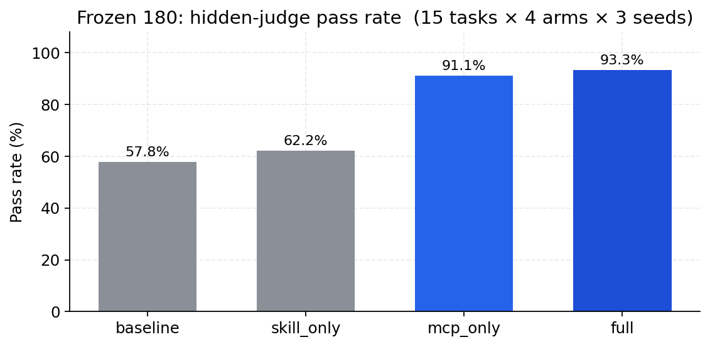
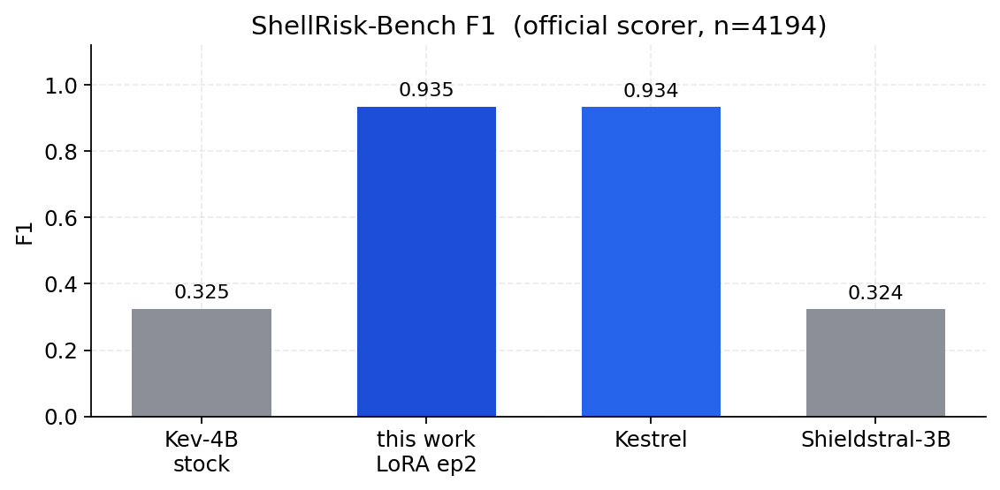

# mini-swe-harness

A **sidecar eval harness** on [mini-swe-agent](https://github.com/SWE-agent/mini-swe-agent) v2. One native tool: **bash**. This repo does **not** fork the agent loop.

It answers two questions, reported **separately**:

1. Do Agent Skills and MCP cause a measurable lift on a frozen 180-episode ablation?
2. Can a Jev-style System One classifier sit beside that loop and review each bash command on a public mix of safe and unsafe commands?

This is **not SWE-bench**. The 15-task catalog is synthetic and auto-gradable so a Skill or a private ticket can matter. Do not compare the **93.3%** to anyone’s SWE-bench score, and **do not mix it with the Jev / Kev numbers below**.

## At a glance

Same figures as the project bullets. Coding agent: Qwen 3.8 27B via local vLLM.

| Claim | Setting | Number |
|---|---|---|
| Frozen 180, MCP on | 15 tasks × 4 arms × 3 seeds | **57.8% → 91.1%** (full **93.3%**) |
| Skills progressive disclosure | 6 tasks where edge rules live only in the Skill | **38.9% → 88.9%** |
| MCP gateway | list → read ticket → solve | multi-ticket **3/3**; avg steps **20.6 → 14.5**; timeouts **17 → 4** |
| Jev-style System One | [ShellRisk-Bench](https://huggingface.co/datasets/kontext-security/ShellRisk-Bench) test, n=4194 | stock F1 **0.32** / recall **26.4%** → LoRA F1 **0.935** / recall **96.9%** (ties Kestrel **0.93**) |

Kev is off unless `KEV_BASE_URL` is set. Frozen 180 / Skill Lift / Lite-25 never go through it by default.

---

## Frozen 180: Skills / MCP ablation

Primary metric: **hidden-judge pass rate**. 15 tasks × 4 arms × 3 seeds = **180** episodes. MCP’s jump is a **controlled capability extension** (the agent can read a private ticket), not a 2× coding upgrade.



| Arm | Skills | MCP gateway | Pass | Rate | vs baseline |
|---|---|---|---|---|---|
| baseline | off | off | 26/45 | **57.8%** | — |
| skill_only | on | off | 28/45 | 62.2% | +4.4 pp |
| mcp_only | off | on | 41/45 | **91.1%** | +33.3 pp |
| full | on | on | 42/45 | **93.3%** | +35.6 pp |

Process (same 180 episodes; timeouts = `TimeExceeded` ∪ `Timeout`, independent of the hidden judge):

| Arm | Pass | avg steps | avg tokens | timeouts |
|---|---|---|---|---|
| baseline | 26/45 | **20.6** | 84k | **17** |
| skill_only | 28/45 | 22.8 | 108k | 19 |
| mcp_only | 41/45 | **14.5** | 53k | **4** |
| full | 42/45 | 14.2 | 55k | 8 |

skill_only is more expensive; gateway arms are shorter and time out less. Do not treat the process table as a second pass ranking.

By category (n=9 each): **bash** and **mcp_opt** are 9/9 on every arm; **skill** is where Skills help (6/9 → 9/9); **mcp-required** is 0 without the gateway (spec lives only in the ticket). The 12-task slice without `mcp_opt` is the right cut for “MCP required” attribution (47.2% → 88.9% mcp_only). Breakdown: [`docs/eval-breakdown.md`](docs/eval-breakdown.md).

`mcp_opt` is a **control**: the same spec is in workspace `README.md` *and* the ticket. All four arms score 9/9; baseline never needs MCP. That is why MCP-required tasks are allowed to hide the spec.

## Skill Lift slice (6 tasks)

Separate catalog (`evals/tasks/skill_lift/`). Happy path is in the workspace; edge rules live only in three Skills (`parse-money`, `parse-records`, `schedule-window`). Startup prompt injects **name + description** only; the model `cat`s `SKILL.md` on hit. Primary comparison: **skill_only vs baseline**. 6 tasks × 4 arms × 3 seeds = **72** episodes. **Do not average with 93.3%.**

| Arm | Skills | MCP gateway | Pass | Rate | vs baseline |
|---|---|---|---|---|---|
| baseline | off | off | 7/18 | **38.9%** | — |
| skill_only | on | off | 16/18 | **88.9%** | +50.0 pp |
| mcp_only | off | on | 7/18 | 38.9% | +0.0 pp |
| full | on | on | 17/18 | 94.4% | +55.6 pp |

Trigger (expected `SKILL.md` in the trajectory): skill_only 18/18, baseline 0/18. Compliance (pass AND trigger): skill_only 88.9%, full 94.4%. mcp_only matches baseline — these tasks have no ticket. Details: `evals/results/skill_lift/summary.json`.

## MCP policy slice (2 tasks)

Separate catalog (`evals/tasks/mcp_policy/`) and policy file (`config/policy.mcp_policy.yaml`: `get_ticket` + `list_tickets`; `workspace_fs` denied). Frozen 180 still uses `policy.eval.yaml`. Tools never enter native function calling: bash `mcp-call` hits an episode HTTP gateway. **policy-list-01** splits the spec across two tickets (must list, then read both). **policy-deny-01** baits `workspace_fs.read_file`. 2 × 4 × 3 = 24 episodes. **Do not average with 93.3%.**

| Arm | Pass | list | deny | vs baseline |
|---|---|---|---|---|
| baseline | 0/6 | 0/3 | 0/3 | — |
| skill_only | 0/6 | 0/3 | 0/3 | +0 |
| mcp_only | 5/6 | **3/3** | 2/3 | +5 |
| full | 5/6 | **3/3** | 2/3 | +5 |

No gateway → 0. Multi-tool list+read is **3/3** with the gateway. Details: `evals/results/mcp_policy/summary.json`.

---

## Jev-style System One (bash auto-review)

[Jev](https://docs.typesafe.ai/api) (TypeSafe System One) is a calibrated decision model, not a chat model. This repo uses the open [Kev](https://github.com/jaredpalmer/kev) server (`POST /v1/systemone`) as a **host-side sidecar** around `DockerEnvironment.execute`: each bash command is scored before `docker exec`. The loop is unmodified. Fail-open if Kev is down.

This is **not a fifth eval arm** and is **not mixed into 93.3%**. Off unless `KEV_BASE_URL` is set.

Headline numbers are on the public **[ShellRisk-Bench](https://huggingface.co/datasets/kontext-security/ShellRisk-Bench) v0.1** test split (4194 commands: 193 risky / 4001 not-risky; official scorer). Dummy always-safe accuracy is ~95.4%, so **F1 and recall** are the metrics that matter. LoRA (rank 16) is trained on the official **train** split only, from `jaredpalmer/kev-4b`. Checkpoint used below: epoch 2 (highest recall; epoch 3 F1 is 0.938 but misses more attacks).



| System | F1 | Precision | Recall | TP | FN | FP |
|---|---:|---:|---:|---:|---:|---:|
| Kev-4B stock | 0.325 | 0.422 | 26.4% | 51 | 142 | 70 |
| **this work (LoRA, epoch 2)** | **0.935** | **0.903** | **96.9%** | **187** | **6** | **20** |
| Kestrel (published, same split) | 0.934 | 0.947 | 92.2% | — | — | — |
| Shieldstral-3B @0.5 (published) | 0.324 | 0.406 | 26.9% | — | — | — |

Stock Kev-4B matches Shieldstral’s band. After two LoRA epochs it **ties Kestrel** on F1 and is higher on recall (187/193 risky commands caught). Reloaded live `kev.serve` + official `python -m shellrisk_bench.score`; 0 scoring errors.

Kestrel / Shieldstral rows are from the ShellRisk-Bench `results.json` table, not re-run here.

---

## What it adds (sidecar only)

1. **Skills, progressive disclosure.** The prompt lists `name` + `description`. The model `cat`s `SKILL.md` and `references/` when it wants them. Bodies are not dumped into the system prompt.
2. **MCP as bash.** `mcp-call` talks to an episode **policy gateway** (Streamable HTTP). Tools are never injected into `litellm.completion(tools=...)`. A CLI allowlist is **not** the security boundary — the agent has arbitrary bash.
3. **Four-arm ablation** on the synthetic catalog, plus a hidden pytest judge the agent never sees.
4. **Optional Jev-style review** (off by default). Host wrapper → local Kev `POST /v1/systemone` on the bash command only (not the episode prompt). Scores live on ShellRisk-Bench, not on the frozen 180.

## Architecture

```
host runner  --LiteLLM-->  vLLM :8000
     |  optional: ReviewedEnvironment --HTTP--> Kev  POST /v1/systemone
     | DockerEnvironment (mini-swe-agent, unmodified loop)
     v
agent container (non-root, cap-drop ALL, read-only rootfs, only /workspace writable)
     |  bash: edit code, pytest (visible tests), cat SKILL.md, mcp-call
     v
policy gateway container (same internal network, no egress)
     |  allowlist + audit jsonl
     +-- stdio --> ticket MCP
            tickets bind-mounted here only — not on the agent disk
```

After the agent exits, a **judge** container runs hidden tests from `evals/graders/`. Visible tests are intentionally weak (often “the function exists”).

## Layout

- `.agents/skills/` — `pytest-debug`, `repo-qa`, `mcp-ticket-context`
- `src/mini_swe_harness/` — catalog, policy, MCP bridge, gateway, runner, report
- `config/policy.eval.yaml` — frozen-180 allowlist: `ticket.get_ticket` only
- `config/policy.mcp_policy.yaml` — MCP-policy catalog: `get_ticket` + `list_tickets`
- `config/kev_review.yaml` — Kev deny threshold (used only when `KEV_BASE_URL` is set)
- `evals/tasks/` — 15 yaml specs
- `evals/graders/` — hidden tests (never mounted into the agent)
- `evals/tickets/` — private ticket bodies (gateway only)
- `docs/design.md` — locked choices, including why not SWE-agent / full SWE-bench
- `docs/eval-breakdown.md` — per-category rates and why skill_only barely moves the total

## Setup

Python 3.11+, Docker Engine, OpenAI-compatible endpoint (this machine: vLLM on `localhost:8000`).

```bash
uv sync --extra dev --extra host
cp .env.example .env   # LITELLM_MODEL must match GET /v1/models
docker build -f docker/Dockerfile -t mini-swe-harness:local \
  --build-arg BASE_IMAGE=docker.m.daocloud.io/library/python:3.12-slim .
```

If Docker Hub is reachable, omit `--build-arg`. Unit tests need neither GPU nor Docker:

```bash
uv run pytest -q
```

## Eval

Do **not** pass `--force` on the published 180 episodes. Existing `evals/results/raw/*.result.json` are skipped; killing the process must not require a rerun.

```bash
# rebuild summary.json from disk (safe)
uv run mini-swe-harness summarize

# smoke one episode
sg docker -c 'uv run mini-swe-harness run --task evals/tasks/bash-fizz-01.yaml --arm baseline --seed 1'

# full catalog: 15 × 4 × 3; skips rows that already exist
sg docker -c 'uv run mini-swe-harness eval --arm all --seeds 1,2,3'
```

External (non-synthetic) subsets belong under `evals/external/` and **must not** be averaged with the synthetic catalog. A 25-id SWE-bench Lite sample is in `evals/external/summary.json`: baseline **18/25**, skill_only **20/25** (`pytest-debug` + `repo-qa` only; +2, no regressions). Failure labels: `evals/external/failure-taxonomy.md`.

## Kev auto-review (optional)

Kev is TypeSafe System One, not a chat model. Do not put it in `LITELLM_MODEL`. Serve it on the **host** (the agent container has no egress):

```bash
# from a Kev checkout
uv run --extra serve python -m kev.serve --run jaredpalmer/kev-4b --port 8009
```

```bash
export KEV_BASE_URL=http://127.0.0.1:8009
# observe: score every bash action, never block
sg docker -c 'uv run mini-swe-harness run --task evals/tasks/bash-fizz-01.yaml --arm baseline --seed 1'

# enforce: deny when the configured noul is at or above deny_threshold
sg docker -c 'uv run mini-swe-harness run --task evals/tasks/bash-fizz-01.yaml --arm baseline --seed 1 --kev-enforce'
```

Observe is the default when the URL is set. A Kev outage is fail-open (logged, command still runs). The System One `state` is the bash command plus a sandbox hint — **not** the episode prompt. Per-action rows go to `raw/*.kev-audit.jsonl`. This is **not** mixed into the 93.3% table.

Isolated catalog (`evals/tasks/kev_review/`) is protocol debug only. When a Kev GPU is up, do not `--arm all`.

```bash
KEV_BASE_URL=http://127.0.0.1:8009 uv run python scripts/kev_smoke.py
```

## What this repo will not do

Fork mini-swe-agent, replace it with SWE-agent, inject MCP into model tool-calling, run SWE-bench Verified/Lite **full**, treat CLI allowlists as isolation, or copy private intern skills.
